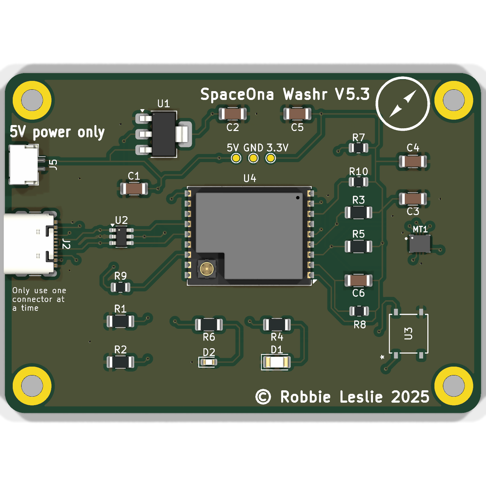
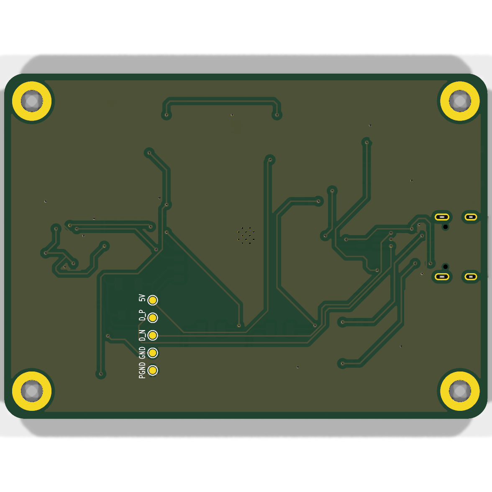
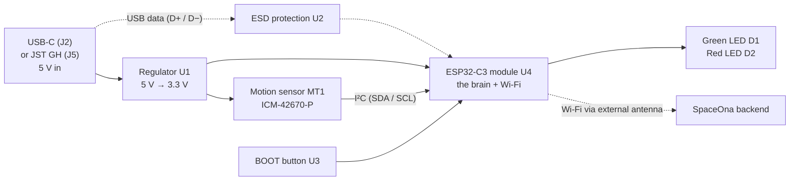

# Washr Board V5.3

The Washr Board is the small circuit board SpaceOna sticks onto a washing machine or dryer. It
feels the machine vibrating, decides whether the machine is running, and reports that over Wi-Fi
so students can see which machines are free.

This README is written for someone with **no electronics background**. It explains what every part
on the board does, how the parts work together, and how to get boards manufactured and assembled.

| Top | Bottom |
| --- | --- |
|  |  |

- Board size: 70.2 mm × 50.2 mm, 2 copper layers, 1.6 mm thick, 4 × M3 mounting holes
- Designed in KiCad by Robbie Leslie. The schematic is in [`docs/WashrBoard-schematic.pdf`](docs/WashrBoard-schematic.pdf)
- Everything you need to order it is in [`fab/`](fab/)

---

## Contents

1. [The 30-second version](#1-the-30-second-version)
2. [Where the board fits in the SpaceOna system](#2-where-the-board-fits-in-the-spaceona-system)
3. [Electronics crash course](#3-electronics-crash-course)
4. [How the board works, block by block](#4-how-the-board-works-block-by-block)
5. [What happens when you plug it in](#5-what-happens-when-you-plug-it-in)
6. [Parts list: what to buy and what each part does](#6-parts-list-what-to-buy-and-what-each-part-does)
7. [Cost estimate](#7-cost-estimate)
8. [Ordering from JLCPCB, step by step](#8-ordering-from-jlcpcb-step-by-step)
9. [When the boards arrive: bring-up checklist](#9-when-the-boards-arrive-bring-up-checklist)
10. [Known quirks and ideas for the next revision](#10-known-quirks-and-ideas-for-the-next-revision)
11. [Glossary](#11-glossary)
12. [Files in this repo](#12-files-in-this-repo)

---

## 1. The 30-second version

1. **Power comes in** as 5 V, from a USB-C cable or a small locking JST connector.
2. **A regulator turns 5 V into 3.3 V**, because the chips on the board run on 3.3 V and would be
   damaged by 5 V.
3. **A motion sensor (IMU)** measures acceleration about 10 times a second.
4. **The ESP32-C3** (a tiny computer with Wi-Fi) reads the sensor. If the readings keep changing,
   the machine is shaking, so it must be running.
5. **The ESP32 sends "in use" or "free" over Wi-Fi** to the SpaceOna server. The website then shows it.
6. **Two LEDs** blink so you can see what the board is doing. **A button** is used when loading new
   software onto it.

That's the whole board. Everything else on it (resistors, capacitors) helps those main parts work
reliably.

---

## 2. Where the board fits in the SpaceOna system

| Piece | Repo | What it does |
| --- | --- | --- |
| **This board (hardware)** | [Spaceona/WashrBoard](https://github.com/Spaceona/WashrBoard) | Senses vibration, talks Wi-Fi |
| Firmware (the code running on the board) | [Spaceona/Washr](https://github.com/Spaceona/Washr) | Detection algorithm, Wi-Fi, server communication. Build with the PlatformIO `custom-board` environment |
| Backend (server) | [Spaceona/backend-go](https://github.com/Spaceona/backend-go) | Stores machine status, authenticates boards, serves firmware updates |
| Website | [Spaceona/washr-frontend-react](https://github.com/Spaceona/washr-frontend-react) | Shows students which machines are free |

The hardware only has to do three things well: stay powered, sense vibration, and connect to Wi-Fi.
All of the "is the machine running?" logic lives in the firmware.

---

## 3. Electronics crash course

You only need a handful of ideas to read this board.

**Voltage, current, ground.** Think of water in pipes. *Voltage* (volts, V) is the pressure,
*current* (amps, A, or milliamps, mA) is how much water flows, and *ground* (GND) is the drain
everything returns to. It is the 0 V reference point. Every circuit is a loop: current leaves the
supply, goes through a part, and returns through GND.

**Power = voltage × current.** Whatever power a part "wastes" turns into heat.

**Resistor (R).** A part that limits how much current can flow. Its value is in ohms (Ω); "10k" means
10,000 Ω. On this board resistors do two jobs: they limit LED current, and they act as **pull-ups**
(explained below).

**Capacitor (C).** A tiny rechargeable reservoir of charge. Chips draw current in sudden gulps (the
Wi-Fi radio especially). A capacitor placed right next to a chip supplies those gulps instantly, so
the voltage doesn't dip. This is called **decoupling**. Values are in farads: µF (microfarads) and
nF (nanofarads).

**LED (D).** A light that only lets current through in one direction. It needs a resistor in series,
or it will draw too much current and burn out.

**IC / chip (U).** A packaged circuit that does something complex: regulate power, run code, sense motion.

**Digital signals.** A chip pin is either **HIGH** (≈3.3 V, logic 1) or **LOW** (≈0 V, logic 0).
A **GPIO** ("general-purpose input/output") is a pin the software can read or drive.

**Pull-up resistor.** A resistor from a pin to 3.3 V. It makes the pin read HIGH by default, but
anything that connects the pin to GND (like a button) easily wins and makes it LOW. Without one, an
unconnected pin "floats" and reads random values.

**I²C.** A way for two chips to talk using just two wires: **SCL** (clock, the "tick" that sets the
pace) and **SDA** (data). Each chip on the bus has an address. This board's IMU uses address `0x68`.
I²C lines need pull-up resistors to work.

**USB data.** USB carries data on two wires, **D+** and **D−**. They always work as a pair.

**Reference designators.** Each part has a letter plus a number printed next to it: **R** resistor,
**C** capacitor, **D** diode/LED, **U** chip, **J** connector or test pad, **H** mounting hole.
**MT1** is the motion sensor, a naming choice from its custom footprint.

---

## 4. How the board works, block by block

The schematic is split into labelled boxes. Each one is explained below, in the order electricity
flows through the board.

### 4.1 USB-C port (J2, R1, R2)

USB-C is where power (and optionally data) comes in.

- **VBUS** is the 5 V power wire from the cable.
- **R1 and R2 (5.1 kΩ) on the CC1 and CC2 pins.** A USB-C charger won't turn its 5 V on until it
  "sees" a device. These two resistors to GND are how the board says "I'm a device, please send
  5 V". There are two because a USB-C plug can go in either way up. **Without them, a USB-C to
  USB-C cable would give the board 0 V.**
- **D+ and D−** are wired to both rows of the connector (A6/B6 and A7/B7), again so the plug works
  either way up. They go through the ESD protector (U2) to the ESP32.
- SBU1/SBU2 (for alternate modes like video) are unused.

### 4.2 JST power connector (J5)

A small 2-pin connector that **latches** so it can't vibrate loose. That matters when you're mounted
on a washing machine. It only carries **5 V and GND, no data**.

> ⚠️ **Only plug in one power source at a time** (it's printed on the board). USB-C and the JST
> connector are wired straight together on the same 5 V line. If both are connected, the two
> supplies push current into each other.
>
> ⚠️ **5 V only.** The regulator can take at most 5.5 V. Feeding the JST 9 V or 12 V will destroy it.

### 4.3 USB protection (U2, USBLC6-2SC6)

When you touch a USB connector you can zap it with thousands of volts of static electricity (ESD).
U2 sits in the D+/D− lines. It does nothing during normal operation, and during a static spike it
dumps the spike into GND before it reaches the ESP32. D+/D− pass straight through U2 (pins 1↔6 and 3↔4).

### 4.4 5 V → 3.3 V regulator (U1, C1, C2)

The ESP32 and the IMU run on 3.3 V. U1 (**TLV1117LV33**) is a *linear regulator* (an "LDO"). It takes
the 5 V in and holds its output at a steady 3.3 V, burning off the difference as a little heat.

- **C1 (1 µF)** on the input and **C2 (1 µF)** on the output keep the regulator stable. Its datasheet
  requires them.
- U1 can supply up to 1 A. The ESP32 draws tens of mA on average, with short peaks of about
  350 mA while it transmits Wi-Fi. That leaves plenty of margin.
- Heat: even at a pessimistic 0.1 A average, (5 V − 3.3 V) × 0.1 A ≈ 0.17 W. The big metal tab on the SOT-223 package spreads
  that into the board.

### 4.5 The brain: ESP32-C3-WROOM-02U (U4)

The big metal-shielded rectangle is a **module**: a complete little computer already built and
certified. Inside the shield there is an ESP32-C3 chip (160 MHz RISC-V processor, 400 KB RAM),
4 MB of flash memory (the "N4" in the name) that stores the firmware, a crystal (the clock), and
the Wi-Fi/Bluetooth radio. Using a module is why this board needs so few extra parts.

**"02U" means the module has no built-in antenna.** It has a tiny **U.FL (IPEX) connector** instead,
the gold circle in the corner of the module. **You must plug an external 2.4 GHz antenna into it**
(see the parts list). Without one, Wi-Fi range is only a few centimetres. The external antenna
also lets the antenna sit outside a metal washing-machine panel, which a built-in antenna couldn't.

The ESP32-C3 has **USB built in** (on GPIO18/19). That means the same USB-C cable powers the
board, uploads new firmware, and shows `Serial.print` output. No separate USB-to-serial chip is needed.

**Pin map**, meaning which ESP32 pin connects to what:

| ESP32-C3 pin | Connected to | Why |
| --- | --- | --- |
| 3V3 | +3.3 V | Power |
| GND | Ground | Power return |
| EN | R8 (10 k) pull-up to 3.3 V, C6 (1 µF) | "Enable". HIGH = run, LOW = held in reset |
| GPIO2 | R9 (10 k) pull-up | Strapping pin, must be HIGH at boot (see below) |
| GPIO4 | IMU **SDA**, R5 (4.7 k) pull-up | I²C data |
| GPIO5 | IMU **SCL**, R3 (4.7 k) pull-up | I²C clock |
| GPIO6 | R4 (75 Ω) → **green LED D1** | `led_1` in firmware |
| GPIO8 | R10 (10 k) pull-up | Strapping pin, must be HIGH to load firmware |
| GPIO9 | R7 (10 k) pull-up, **BOOT button U3**, pad J7 | Strapping pin. LOW at boot = "download mode" |
| GPIO10 | R6 (75 Ω) → **red LED D2** | `led_2` in firmware |
| GPIO18 | USB D− (through U2) | Native USB |
| GPIO19 | USB D+ (through U2) | Native USB |
| GPIO0, 1, 3, 7, 20 (RX), 21 (TX) | Not connected | Spare |

**Strapping pins, explained.** At the instant the ESP32 powers up, it glances at a few pins
(GPIO2, 8 and 9) to decide *how* to start:

- GPIO9 **HIGH** (default, thanks to R7) → run the firmware already stored in flash (normal).
- GPIO9 **LOW** (you're holding the BOOT button) → start the built-in bootloader and wait for new
  firmware over USB ("download mode").
- GPIO8 must be HIGH for download mode to work, and GPIO2 should be HIGH too. R10 and R9 guarantee that.

**EN / reset (R8, C6).** EN must be HIGH for the chip to run. R8 pulls it HIGH. See
[known quirks](#10-known-quirks-and-ideas-for-the-next-revision) for a note about C6.

### 4.6 Motion sensor / IMU (MT1, ICM-42670-P, C3, C4, C5)

An **IMU** ("inertial measurement unit") contains a 3-axis **accelerometer**, which measures
acceleration, including gravity and vibration, and a 3-axis **gyroscope**, which measures rotation.
When a washing machine spins, the accelerometer readings jitter. That jitter is what the firmware
looks for.

How it's wired:

- **VDD and VDDIO → 3.3 V.** VDD powers the sensor and VDDIO sets the voltage its signal pins use.
- **AP_CS → 3.3 V.** Tying this pin HIGH tells the chip "talk I²C, not SPI".
- **AP_AD0 → GND.** This sets the I²C address to `0x68`, which matches `ICM42670 imu(Wire, 0)` in the firmware.
- **SCL/SDA → ESP32 GPIO5/GPIO4**, with **R3 and R5 (4.7 kΩ) pull-ups**, as I²C requires.
- **FSYNC → GND.** This is an unused camera-sync feature, and the datasheet says to ground it.
- **INT1/INT2 not connected.** The firmware *asks* the sensor for data every 100 ms ("polling")
  instead of having the sensor interrupt it.
- **C3 (100 nF), C4 (10 nF), C5 (2.2 µF)** are decoupling capacitors placed right next to the
  sensor. They keep its supply clean so the measurements aren't noisy.

The sensor is a tiny 2.5 × 3 mm LGA package with no legs, just pads underneath. It can't be
hand-soldered easily, which is one reason to get the boards machine-assembled.

### 4.7 LEDs (D1, D2, R4, R6)

- **D1 green**, driven by GPIO6 through R4 (75 Ω)
- **D2 red**, driven by GPIO10 through R6 (75 Ω)

The resistors set the LED current. For the green LED that's (3.3 V − 2.2 V LED drop) ÷ 75 Ω ≈ 15 mA,
bright but safe.

What the current firmware does with them:

| LED | Pattern | Meaning |
| --- | --- | --- |
| Green | Two slow blinks (0.5 s) | Finished an onboarding / setup attempt |
| Green | Very short flash | Logged in to the server (authenticated) |
| Green | Short flash | Status successfully sent to the server |
| Red | Short flash | Board successfully onboarded (registered) with the server |

A brand-new board with no firmware shows **no LEDs at all**. That's normal.

### 4.8 BOOT button (U3) and programming pads (J6–J10)

**U3** is the "P9 button". It connects GPIO9 to GND when pressed. Hold it while plugging in USB to
force download mode. You only need it if the board stops showing up as a USB device, for example
after firmware that crashes immediately.

On the **bottom** of the board are five round pads for a **pogo-pin programming jig**. A jig is a
fixture with spring pins that press onto the pads, so many boards can be programmed quickly without
plugging in cables:

| Pad | Label | Signal |
| --- | --- | --- |
| J6 | 5V | VBUS |
| J8 | D_P | USB D+ |
| J9 | D_N | USB D− |
| J10 | GND | Ground |
| J7 | PGND | GPIO9, reached through the button's internal contact |

The jig shorts **J7 to J10**, which holds GPIO9 LOW, so the board powers up in download mode. The
designer's note in the schematic explains that this pad goes through the button so GPIO9 is never
*permanently* tied to ground.

### 4.9 Test points (J1, J3, J4) and mounting holes (H1–H4)

- The three gold dots labelled **5V / GND / 3.3V** on the top are for a multimeter. They're the
  first thing to check if a board seems dead (see [bring-up](#9-when-the-boards-arrive-bring-up-checklist)).
- **H1–H4** are plated M3 holes for ISO 7380 button-head screws.

### 4.10 The PCB itself

- **2 copper layers** (top and bottom). The copper **traces** are the "wires", and small plated holes
  called **vias** (48 of them) connect the two layers.
- Most of the empty copper area is a **ground fill**: a solid sheet of GND copper. It gives every
  part a short return path and helps with noise.
- The green layer is **solder mask**, which insulates the copper and stops solder from spreading.
  The white text is **silkscreen**.

---

## 5. What happens when you plug it in

1. 5 V arrives. U1 produces 3.3 V. EN goes HIGH, so the ESP32 starts.
2. The ESP32 checks the strapping pins. The button isn't pressed, so it boots the firmware from flash.
3. The firmware starts USB serial, starts I²C on GPIO4/5, and configures the IMU for a ±2 g range.
4. **Every 100 ms** it reads the accelerometer and compares it with the previous reading. If any
   axis changed by at least 0.1 m/s², that counts as "motion seen".
5. **Debouncing.** A counter goes up by 1 when motion is seen and down by 1 when it isn't, and stays
   between 0 and 100. When the counter reaches **30** (≈3 seconds of mostly-shaking), the machine is
   marked **in use**. It goes back to **free** once the counter falls below 30 again. That can take
   up to ~7 s after the machine stops. This filters out one-off bumps like someone closing the lid.
6. **Every 5 s** a second state machine handles the network: load Wi-Fi credentials → connect →
   register with the backend the first time (onboarding) → log in and get a token → send
   `{status, confidence, firmware version}` to the server.
7. The backend can also tell the board to download new firmware over Wi-Fi (an OTA update).

The firmware lives in [Spaceona/Washr](https://github.com/Spaceona/Washr). See that README for
setting up `include/wifi_secrets.h`.

---

## 6. Parts list: what to buy and what each part does

This is exactly what is in [`fab/WashrBoard-BOM-JLCPCB.csv`](fab/WashrBoard-BOM-JLCPCB.csv), the
file you upload to JLCPCB. Stock and prices were checked against JLCPCB's parts library on
**2026-09-29**. **Basic** parts are always loaded on JLCPCB's machines (no extra fee). **Extended**
parts cost a one-time $3.07 loading fee each per order.

| Ref | Qty/board | Part | LCSC # | Library | Unit price | What it does |
| --- | --- | --- | --- | --- | --- | --- |
| U4 | 1 | ESP32-C3-WROOM-02U-N4 | C2926676 | Extended | $3.07 | The brain + Wi-Fi/Bluetooth (needs external antenna) |
| MT1 | 1 | ICM-42670-P IMU | C3288646 | Extended | $2.28 | Senses vibration (accelerometer + gyro) |
| J2 | 1 | GCT USB4105-GF-A USB-C | C3020560 | Extended | $1.30 | Power + USB data in |
| U1 | 1 | TI TLV1117LV33DCYR | C15578 | Extended | $0.26 | 5 V → 3.3 V regulator |
| U2 | 1 | ST USBLC6-2SC6 | C7519 | Extended | $0.18 | Static (ESD) protection for USB data |
| U3 | 1 | C&K PTS526SK15SMTR2LFS | C2689521 | Extended | $0.18 | BOOT button |
| D1 | 1 | Broadcom HSMG-C150 green LED (1206) | C188727 | Extended | $0.20 | Status light |
| D2 | 1 | KENTO KT-0603R red LED (0603) | C2286 | Basic | $0.01 | Status light |
| J5 | 1 | XYECONN XY-SM02B-GHS-TB (JST GH, 2-pin) | C54582897 | Extended | $0.04 | Locking 5 V power input |
| C1, C2, C6 | 3 | 1 µF 50 V X7R (1206) | C1848 | Basic | $0.05 | Regulator stability, EN capacitor |
| C3 | 1 | 100 nF 50 V X7R (1206) | C24497 | Basic | $0.02 | IMU decoupling |
| C4 | 1 | 10 nF 50 V X7R (1206) | C1846 | Basic | $0.02 | IMU decoupling |
| C5 | 1 | 2.2 µF 50 V X7R (1206) | C50254 | Basic | $0.09 | IMU decoupling |
| R1, R2 | 2 | 5.1 kΩ 1% (1206) | C26033 | Extended | $0.01 | Tells USB-C chargers to send 5 V |
| R3, R5 | 2 | 4.7 kΩ 1% (1206) | C17936 | Basic | $0.01 | I²C pull-ups |
| R4, R6 | 2 | 75 Ω 1% (1206) | C17987 | Extended | $0.01 | LED current limit |
| R7–R10 | 4 | 10 kΩ 1% (0805) | C17414 | Basic | $0.004 | Pull-ups on GPIO9, EN, GPIO2, GPIO8 |

**Bought separately (not soldered by the factory):**

| Item | Qty/board | Where | Price | Notes |
| --- | --- | --- | --- | --- |
| 2.4 GHz antenna with U.FL / IPEX-1 (MHF1) plug | 1 | LCSC **C1693673** (HJ-2.4G-IPEX1, 80 mm cable) or any "2.4 GHz U.FL antenna" | ≈ $0.57 | Clicks onto the gold connector on U4. Must be U.FL / IPEX **gen 1 / MHF1**, *not* MHF4 (laptop Wi-Fi cards use MHF4, which won't fit) |
| USB-C cable + 5 V USB power adapter | 1 | Anywhere | — | Any phone charger works |
| M3 button-head screws (ISO 7380) | 4 | Hardware store | — | Mounting |

**Changes from the original BOM** (so the board can actually be ordered today):

- **J5**: the genuine JST SM02B-GHS-TB (C189893) had only **2 in stock**. It's replaced by the
  XYECONN XY-SM02B-GHS-TB, which has the same 1.25 mm GH pitch, the same pad layout (checked against
  the datasheet) and mates with the same GH cables.
- **D2**: the ROHM SML-D12U1WT86 was out of stock and is replaced with the JLCPCB Basic KT-0603R (same 0603 size).
- **Passives** use JLCPCB Basic equivalents wherever one exists in the same size, to avoid extra fees.
  There is no Basic 5.1 k or 75 Ω in 1206, so those two are Extended.
- **Designators**: `R7-R10` became `R7,R8,R9,R10`. JLCPCB can't read ranges and would report the
  parts as missing.

---

## 7. Cost estimate

JLCPCB **Economic PCBA**, fees from [JLCPCB's pricing page](https://jlcpcb.com/help/article/pcb-assembly-price)
(last updated 2026-09-09), part prices checked 2026-09-29.

| Line item | 2 boards | **5 boards** | 10 boards |
| --- | ---: | ---: | ---: |
| Bare PCBs (min. 5; 2-layer, 70 × 50 mm, HASL) | ~$2 | ~$2 | ~$5 |
| Assembly setup fee | $8.18 | $8.18 | $8.18 |
| Stencil | $1.53 | $1.53 | $1.53 |
| Solder joints (128/board × $0.0016) | $0.41 | $1.02 | $2.05 |
| Extended-part loading fee (10 × $3.07) | $30.70 | $30.70 | $30.70 |
| Components (incl. JLCPCB minimum order qty) | ~$34 | ~$50 | ~$77 |
| **Subtotal (before shipping / tax)** | **≈ $77** | **≈ $94** | **≈ $125** |
| Antennas (LCSC, ~$0.57 each) | ~$1 | ~$3 | ~$6 |

On top of that:

- **Shipping:** roughly $15–30 by express courier (DHL/FedEx/UPS), cheaper and slower with
  JLCPCB's economy lines.
- **Import duties / tariffs:** shown at checkout and depend on your country. For US addresses this
  is currently a noticeable extra, so check the number before paying.
- **Budget ≈ $120–150 landed for 5 working boards.**

Why a small order costs this much:

- **The $30.70 of extended-part fees and $9.71 of setup/stencil are charged once per order**, however
  many boards you order. That's why the per-board price drops quickly with quantity.
- Some parts have **minimum order quantities** at JLCPCB. For example, the regulator must be bought
  in 35s (≈ $9) and the USB-C connector in 7s. The leftovers are stored in your JLCPCB account's
  parts inventory for your next order.
- The ESP32 module, IMU and USB-C connector together are ~$6.65 of the ~$7.80 of parts on each board.

**PCBWay** can build the same board, but they quote assembly by hand (about a day) and buy parts
from distributors themselves. For 2–10 boards that usually costs more than JLCPCB. It's a good fallback
if JLCPCB runs out of a part. Upload the same gerbers, the BOM (PCBWay uses the `Manufacturer` + `MPN`
columns) and the CPL file (they call it "centroid").

---

## 8. Ordering from JLCPCB, step by step

You need three files:

| File | What it is | Where |
| --- | --- | --- |
| **Gerber zip** | The PCB drawings the factory uses to make the bare board (one file per copper, mask and silkscreen layer, plus drill files) | Generate from KiCad (below). Gerbers are git-ignored in this repo |
| **BOM** (bill of materials) | Which part goes where | [`fab/WashrBoard-BOM-JLCPCB.csv`](fab/WashrBoard-BOM-JLCPCB.csv) |
| **CPL** (component placement list) | The X/Y position and rotation of every part, for the pick-and-place robot | [`fab/WashrBoard-CPL-JLCPCB.csv`](fab/WashrBoard-CPL-JLCPCB.csv) |

**Making the gerber zip in KiCad** (open `WashrBoard.kicad_pro`, then the PCB editor):

1. *File → Fabrication Outputs → Gerbers*. Tick F.Cu, B.Cu, F.Paste, B.Paste, F.Silkscreen,
   B.Silkscreen, F.Mask, B.Mask and Edge.Cuts. Click **Plot**.
2. In the same window click **Generate Drill Files…**, then **Generate**.
3. Zip all the files it created into one `.zip`.

**On jlcpcb.com:**

1. Click **Order Now / Instant Quote** and upload the gerber zip. It should detect **2 layers,
   70.2 × 50.2 mm**.
2. PCB options: Qty **5**, thickness **1.6 mm**, any colour (green is fastest). Surface finish
   **HASL** is fine. **ENIG** (gold) gives flatter pads, which helps the tiny leadless IMU, but
   costs more. Leave the other options on their defaults.
3. Turn on **PCB Assembly**: type **Economic**, side **Top**, PCBA qty **5** (or 2), tooling holes
   **Added by JLCPCB**. Click **Next**.
4. Upload **BOM** = `WashrBoard-BOM-JLCPCB.csv` and **CPL** = `WashrBoard-CPL-JLCPCB.csv`. If it
   asks you to match columns: Comment → Comment, Designator → Designator, Footprint → Footprint,
   LCSC Part # → JLCPCB Part #.
5. On the parts page, **all 17 lines should be matched and in stock**. If one shows a shortage, click
   it and choose another part with the same value and package (e.g. "1206", "0805").
6. **Check the placement preview carefully.** KiCad and JLCPCB sometimes disagree on rotation. For
   each part, the **pin-1 dot** in the preview should sit on the pin-1 mark of the footprint. Pay
   special attention to **U1, U2, U4, MT1** and the LED polarity of **D1/D2**. Also check that
   **J2 and J5 face off the board edge**. Rotate anything that's wrong in the viewer.
7. **Save to Cart**. Add the antennas on **lcsc.com** (C1693673). JLCPCB and LCSC are sister
   companies, so you can use the same login. Then check out.
8. A JLCPCB engineer reviews every order (DFM review). They may email or post questions on the order
   page, for example about a part rotation or about the connectors hanging over the board edge.
   Answer them promptly or the order waits.

---

## 9. When the boards arrive: bring-up checklist

1. **Look** at each board under good light: no obvious solder blobs bridging pins, and U4, MT1 and
   the LEDs are the right way round.
2. **Short test (unpowered).** Set a multimeter to resistance/continuity. Measure between the
   **5V** and **GND** test points, then between **3.3V** and **GND**. You should *not* see ~0 Ω
   (a beep). A beep means a short, so don't power that board.
3. **Plug in the antenna** (push the U.FL plug straight down until it clicks) *before* running
   Wi-Fi firmware.
4. **Power it over USB-C.** Measure **3.3V → GND**. It should read 3.25–3.35 V. Nothing should get
   hot. A blank board shows no LEDs, which is normal.
5. **Flash the firmware.** Open [Spaceona/Washr](https://github.com/Spaceona/Washr) in PlatformIO,
   select the **`custom-board`** environment, create `include/wifi_secrets.h`, then Upload.
   - If no USB port appears, **hold the BOOT button (U3)**, plug in USB, release, and upload again.
6. **Open the serial monitor** (115200 baud). You should see it connect to Wi-Fi and talk to the
   server, and the green LED should flash on each successful status update.
7. **Shake it.** Tap the board on a table repeatedly for a few seconds. The reported status should
   switch to "in use", then back to "free" a few seconds after you stop.

---

## 10. Known quirks and ideas for the next revision

These don't stop V5.3 from working, but they're worth knowing:

1. **C6 is wired from 3.3 V to EN instead of from EN to GND.** Espressif recommends a 10 kΩ pull-up
   plus a 1 µF capacitor *to ground* on EN. That delays start-up by a few milliseconds until the supply is
   stable. With C6 connected to 3.3 V, the delay doesn't happen: EN rises at the same moment as the
   supply. From a normal USB supply the ESP32's internal power-on reset still handles this. If a
   board ever fails to start on power-up but works after replugging, this is the first suspect.
   The fix for V5.4 is to move C6 pin 1 from +3.3V to GND.
2. **No protection between the USB-C and JST 5 V inputs** (hence "Only use one connector at a
   time"). A Schottky diode or a small "ideal diode" chip on each input would make it safe to plug
   in both.
3. **No reverse-polarity or over-voltage protection on the JST input.** A backwards or 12 V
   cable will damage the board.
4. **The IMU interrupt pins aren't connected**, so the ESP32 must stay awake and poll. That's fine
   on USB power. For a battery version, wiring INT1 to a spare GPIO would allow deep sleep with
   wake-on-motion.
5. **Part availability.** The genuine JST GH connector ran out at JLCPCB (the clone is used above).
   Stock of the regulator (C15578, a few hundred left) and the ESP32 module (C2926676, about 800 left)
   is worth checking before each order.
6. **KiCad version.** The design files are saved in KiCad 8 format. Opening them in KiCad 9/10
   rewrites them in the newer format. Don't commit that upgrade unless the whole team moves to the
   new version.

---

## 11. Glossary

| Term | Meaning |
| --- | --- |
| **BOM** | Bill of materials: the list of parts to buy |
| **CPL / centroid / pick-and-place file** | Position + rotation of each part for the assembly robot |
| **Gerber** | The standard file format that describes each PCB layer |
| **PCB / PCBA** | Printed circuit board / PCB *Assembly* (board with parts soldered on) |
| **SMT / SMD** | Surface-mount technology/device: parts soldered on top of pads, not through holes |
| **Stencil** | Metal sheet used to print solder paste onto the pads before parts are placed |
| **Reflow** | Oven step that melts the solder paste so parts are soldered in place |
| **Footprint** | The copper pad pattern on the PCB for one part |
| **1206 / 0805 / 0603** | Standard sizes for small parts: 1206 = 3.2 × 1.6 mm, 0805 = 2.0 × 1.25 mm, 0603 = 1.6 × 0.8 mm |
| **LCSC part #** | The "C12345" catalogue number JLCPCB uses to identify a part |
| **Basic / Extended part** | JLCPCB parts that are always loaded on the machines (free) / loaded just for you ($3.07 each per order) |
| **LDO** | Low-dropout linear regulator: turns a higher voltage into a lower, steady one |
| **ESD / TVS** | Electrostatic discharge (static shock) / the protection diodes that absorb it |
| **IMU** | Inertial measurement unit: accelerometer + gyroscope |
| **I²C** | Two-wire chip-to-chip bus (SCL clock + SDA data) |
| **GPIO** | General-purpose input/output pin |
| **Pull-up** | Resistor that makes a pin read HIGH unless something pulls it LOW |
| **Decoupling capacitor** | Capacitor next to a chip that keeps its supply voltage steady |
| **Strapping pin** | A pin the ESP32 reads at power-up to decide how to boot |
| **U.FL / IPEX / MHF1** | Tiny snap-on RF connector for the external antenna |
| **OTA** | Over-the-air firmware update via Wi-Fi |
| **DFM** | Design for manufacturing: the factory's check that your board can be built |

---

## 12. Files in this repo

| Path | What it is |
| --- | --- |
| `WashrBoard.kicad_pro` | KiCad project file. Open this one |
| `WashrBoard.kicad_sch` | Schematic (the circuit diagram) |
| `WashrBoard.kicad_pcb` | PCB layout (where parts and traces physically go) |
| `Library/` | Custom symbols, footprints and 3D model for the IMU, the button and the SpaceOna logo |
| `docs/WashrBoard-schematic.pdf` | Schematic as a PDF, readable without KiCad |
| `docs/images/` | 3D renders of the top and bottom of the board |
| `fab/WashrBoard-BOM-JLCPCB.csv` | Upload-ready BOM with LCSC part numbers |
| `fab/WashrBoard-CPL-JLCPCB.csv` | Upload-ready placement file |

Older board revisions are archived in [Spaceona/WashrBoardArchive](https://github.com/Spaceona/WashrBoardArchive).
